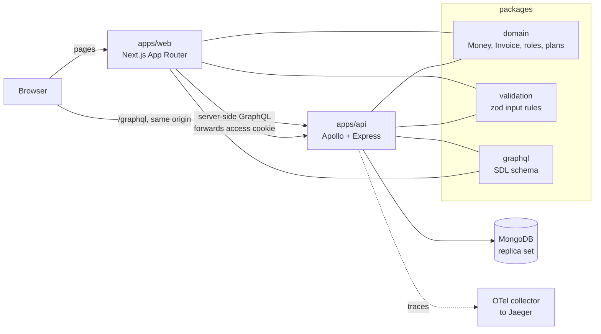
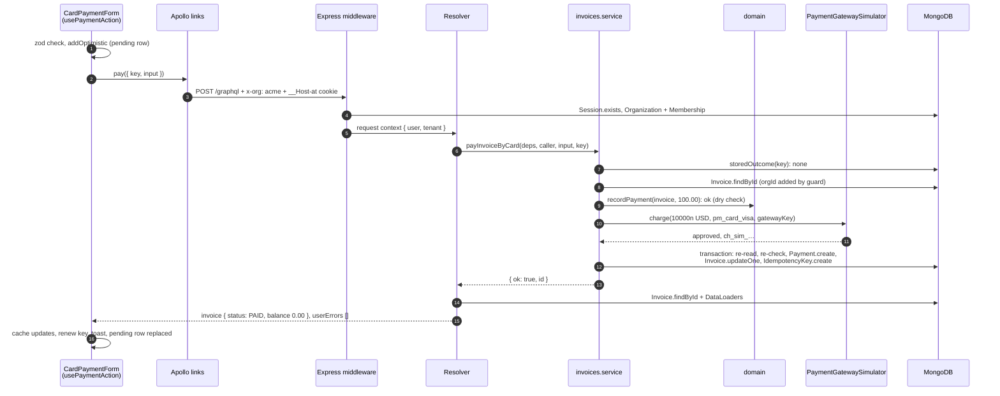

# Ledgerly codebase tour

How the code is laid out, how a request moves through it, and the few rules that keep it correct.
Read it once from top to bottom, then keep it open while you read the code.

Written as of the end of Phase 4. When the code and this page disagree, the code and
[`CLAUDE.md`](../CLAUDE.md) win, and this page should be fixed.

| Product                | Front end            | API                        | Data                  | Language                | Repo                      |
| ---------------------- | -------------------- | -------------------------- | --------------------- | ----------------------- | ------------------------- |
| Multi-tenant invoicing | Next.js 16, React 19 | Apollo Server 5, Express 5 | MongoDB 9, Mongoose 9 | TypeScript 6.0, Node 24 | pnpm + Turborepo monorepo |

## Contents

1. [What Ledgerly is](#1-what-ledgerly-is)
2. [The map](#2-the-map)
3. [Shared packages](#3-shared-packages)
4. [The API](#4-the-api-appsapi)
5. [The web app](#5-the-web-app-appsweb)
6. [One request, end to end](#6-one-request-end-to-end)
7. [Dry run, module by module](#7-dry-run-module-by-module)
8. [Doing things exactly once](#8-doing-things-exactly-once)
9. [The rules and why](#9-the-rules-and-why)
10. [How we test](#10-how-we-test)
11. [Adding a feature](#11-adding-a-feature)
12. [Your first week](#12-your-first-week)
13. [Known gaps](#13-known-gaps)
14. [Glossary](#14-glossary)

## 1. What Ledgerly is

A small business signs up, creates an **organisation**, adds **customers**, writes **invoices**,
sends them, and records **payments** by hand or by card. One person can belong to several
organisations, each with its own role. The organisation is the **tenant**: nothing from one
organisation may ever leak into another.

It is built in phases as a learning project, so every phase ends with a write-up in
[`docs/learn/phase-N.md`](learn/). Those notes explain the _why_ behind this page in more depth.

| Phase | Scope                     | State   |
| ----- | ------------------------- | ------- |
| 0     | Plan and ADRs             | done    |
| 1     | Monorepo, domain, CI      | done    |
| 2     | API, tenancy, auth        | done    |
| 3     | Web shell                 | done    |
| 4     | Invoices, payments, plans | done    |
| 5     | Admin console             | next    |
| 6–8   | PDFs, theming, AWS        | planned |

Nothing is deployed to AWS yet. Everything runs locally in Docker; the cloud work is Phase 8.

## 2. The map

The browser only ever talks to one origin. The Next.js server renders pages and calls the API on
the user's behalf; the browser calls the API directly for anything interactive. Both share three
packages, so the rules for money, invoices and validation exist exactly once.



```text
ledgerly/
├─ apps/
│  ├─ api/            GraphQL API: data, tenancy, auth, payments
│  └─ web/            Next.js tenant app (pages, components, Redux, Apollo)
├─ packages/
│  ├─ domain/         pure business rules, zero dependencies
│  ├─ validation/     zod schemas shared by forms and resolvers
│  ├─ graphql/        the .graphql schema files, the API's contract
│  └─ config/         shared TypeScript and lint config
├─ docs/adr/          architecture decisions (MADR), never edited once accepted
├─ docs/learn/        one learning note per phase
├─ infra/local/       OpenTelemetry collector config for the local stack
├─ PLAN.md            phases, gates, the whole design
├─ DECISIONS.md       every choice the plan did not make, newest first
└─ CLAUDE.md          the non-negotiable rules, in one page
```

**Folders are feature-first.** You will find `features/invoices/` holding the model, service,
resolvers and tests for invoices together, not a `models/` folder and a `services/` folder. When
you change a feature, you should rarely leave its folder.

## 3. Shared packages

### `packages/domain`: the rules of the business

Plain TypeScript with no dependencies and no I/O. It doesn't know MongoDB, GraphQL or React
exist, which is why the API _and_ the browser can both use it. A dependency rule fails CI if it
ever imports anything.

- **`money/`**: `Money` is a `bigint` count of minor units (cents) plus a `Currency`. Adding USD
  to EUR throws. There is no division; the only rounding is `multiplyAndRound`, half-even.
- **`invoice/`**: the state machine. A table lists which actions each status allows: `DRAFT` →
  edit, send, void; `SENT` → pay, void; `PARTIALLY_PAID` → pay; `PAID` and `VOID` → nothing.
- **`access/`**: roles (`OWNER`, `ADMIN`, `ACCOUNTANT`, `VIEWER`) and the
  `can(role, permission)` table.
- **`billing/`**: the plan catalogue. FREE allows 5 customers, 10 invoices a month and 2 seats;
  PRO and BUSINESS raise or remove those limits.
- **`shared/`**: `Result` (`ok` / `err`). Expected business refusals, such as overpaying an
  invoice, are returned as values, not thrown.

```ts
// Why bigint and not number: 0.1 + 0.2 !== 0.3 in floating point.
const total = Money.parse('19.99', USD).add(Money.parse('0.01', USD)); // 2000n minor units, exact
Money.of(500n, USD).add(Money.of(500n, EUR)); // throws CurrencyMismatchError
```

### `packages/validation`: what valid input looks like

zod schemas such as `CreateInvoiceInput`. The web form validates with the same schema the API
uses, so the user sees the same rule before and after submitting. A _contract test_ checks every
GraphQL input type has a matching zod schema with the same fields.

### `packages/graphql`: the API contract

The schema is written first, by hand, in `schema/tenant/*.graphql`. Code generation turns it into
TypeScript types for both apps, so if the schema and the code disagree, the build fails.

## 4. The API (`apps/api`)

Read `src/` as layers, outside in. A request passes through each of them in this order.

| Folder       | Job                                                                                                                               | Start reading at               |
| ------------ | --------------------------------------------------------------------------------------------------------------------------------- | ------------------------------ |
| `http/`      | Express app: rate limit per IP, cookies, the request context, then Apollo. Also the REST refresh and logout routes.               | `app.ts`                       |
| `context/`   | Who is calling and for which organisation, stored in `AsyncLocalStorage` so any code below can read it without passing it around. | `request-context.ts`           |
| `graphql/`   | Schema assembly, scalars, error formatting, depth and alias limits, pagination, DataLoaders.                                      | `schema.ts`, `errors.ts`       |
| `features/*` | One folder per feature: Mongoose model, service (the logic), resolvers (thin GraphQL glue), tests.                                | `invoices/invoices.service.ts` |
| `data/`      | Database connection, transactions, and the **tenant guard**. The only place allowed to touch the raw MongoDB driver.              | `tenant-guard.ts`              |

### Tenancy: how organisations stay apart

Every tenant collection (customers, invoices, payments…) has an `orgId`. You never write
`{ orgId }` in a query yourself. The tenant guard, a Mongoose plugin, adds it from the request
context to every query and aggregate, and refuses to run if there is no organisation. The
`orgId` never comes from a GraphQL argument, because a caller could put any value there.

> **Gotcha:** Mongoose queries are lazy: `Invoice.find()` does nothing until awaited. Build a
> query inside one tenant context and await it outside, and it runs with no organisation. That's
> why every query chain ends in `.exec()` where it is built.

### Errors come in two kinds

- **GraphQL errors** for "you can't ask this": `UNAUTHENTICATED`, `FORBIDDEN`,
  `BAD_USER_INPUT`.
- **`userErrors` in the payload** for "the business says no": `OVERPAYMENT`,
  `PLAN_LIMIT_REACHED`, `CARD_DECLINED`. Each has a stable `code` and a `field` path, so the form
  can show the message next to the right input, translated.

Anything unexpected is logged in full and returned as "Something went wrong on our side" with a
`traceId`. No stack traces reach the client.

### Authentication

Hand-rolled on purpose so you can see every part ([ADR-0003](adr/0003-hand-rolled-session-auth.md)).
Passwords are hashed with argon2id. Sign-in sets two cookies, both `HttpOnly` so JavaScript can't
read them:

- `__Host-at`: a 10-minute access token (an EdDSA JWT) holding only the user and session ids.
  **Roles are not in it**; they are loaded on every request, so a role change applies
  immediately.
- `__Secure-rt`: a refresh token, sent only to `/graphql/auth`, replaced on every use. Presenting
  an old one twice looks like theft and revokes the whole session.

## 5. The web app (`apps/web`)

```text
src/
├─ app/[locale]/              routes; the locale (en, de, ar) is the first URL segment
│  ├─ (auth)/sign-in, sign-up route group: shared layout, not in the URL
│  └─ o/[orgSlug]/            one organisation's app: dashboard, customers, invoices, billing
├─ features/                  auth, shell, customers, invoices, billing, dashboard
├─ components/form/           Field, SelectField, error mapping, useZodForm
├─ lib/apollo/                rsc.ts (server client), ApolloWrapper.tsx (browser client), links
├─ lib/auth/                  single-flight token refresh, RestoreSession
├─ lib/hooks/                 useIdempotencyKey, usePermission, useMoney, useToast
├─ store/                     Redux Toolkit: ui, toasts, session slices + middleware
├─ messages/{en,de,ar}.json   every visible string, by key
└─ proxy.ts                   picks the locale (Next 16's name for middleware.ts)
```

### Server Components and client components

Files under `app/` are **Server Components** by default: they run only on the server, can be
`async`, and send no JavaScript. A file that starts with `'use client'` is a **client
component**: rendered on the server for the first HTML, then made interactive in the browser.

Our rule of thumb: **fetch on the server, interact on the client.** A page loads its data in a
Server Component, then hands it to a client component, either directly or with
`<PreloadQuery>` + `useReadQuery` so the client can paginate and refetch.

### Who owns which state

| State                                | Owner                     | Example                          |
| ------------------------------------ | ------------------------- | -------------------------------- |
| Data from the server                 | Apollo cache              | invoices, customers, plan usage  |
| What the URL says                    | The URL itself            | invoice filters (`?status=SENT`) |
| App-wide UI state                    | Redux Toolkit             | theme, toasts, mobile menu       |
| One component's state                | `useState` / `useReducer` | invoice line items in the editor |
| "Show it before the server confirms" | `useOptimistic`           | a payment appears as pending     |

The Redux store is created **once per request** by `StoreProvider`. A store at module level
would be shared by every user the Node server is rendering for, leaking one person's state into
another's page.

### Translations and accessibility are part of done

- No visible English in components. Strings live in `messages/*.json` and every key exists in
  all three locales.
- Arabic is right to left. CSS uses logical properties (`margin-inline-start`, not
  `margin-left`), so there is no separate RTL stylesheet.
- Every input has a label; errors are linked to their field with `aria-describedby`; component
  tests run axe and fail on violations.

## 6. One request, end to end

Follow a card payment on an invoice. Open each file as you read its step.

1. **`apps/web/src/app/[locale]/o/[orgSlug]/invoices/[invoiceId]/page.tsx`**: the invoice page is
   a Server Component. It queries the API with the user's access cookie (and only that cookie)
   and the `x-org` header naming the organisation.
2. **`features/invoices/PaymentForms.tsx`**: the user submits the card form.
   `useIdempotencyKey` already holds a UUID for this attempt; `useOptimistic` shows the payment
   as pending straight away.
3. **`lib/apollo/links.ts`**: the browser's Apollo client sends `payInvoiceByCard` to `/graphql`
   on the same origin. If the access token has expired, the refresh link renews it once and
   retries.
4. **`apps/api/src/http/app.ts` → `rate-limit.ts`**: the per-IP limiter runs first. Then the
   request context reads the cookie, verifies the token, loads the session and the caller's
   membership of `x-org`.
5. **`features/invoices/invoices.resolvers.ts`**: the resolver checks the permission
   (`payments:record`) and calls the service. Resolvers stay thin.
6. **`features/invoices/invoices.service.ts` → `payInvoiceByCard`**: if this idempotency key has
   already succeeded, return that result. Otherwise ask the domain whether the payment is legal,
   charge the card _outside_ any transaction, then record it in a transaction. If recording
   fails, refund the charge.
7. **`data/tenant-guard.ts`**: every query in that transaction gets `orgId` from the context
   automatically.
8. **Back in the browser**: the response replaces the optimistic row. A `userErrors` code such as
   `CARD_DECLINED` is translated and shown next to the card field.

Every step appears in one trace in Jaeger (<http://localhost:16686>), down to each MongoDB
command, and every log line carries the same `traceId`. For the same journey traced module by
module, with real values and every branch, see [section 7](#7-dry-run-module-by-module).

## 7. Dry run, module by module

Section 6 is the overview. This is the same card payment traced one module at a time, with real
values, so you can follow it in a debugger. For each module: what comes **in**, what it
**does**, and what goes **out**.

### The scenario

| Thing      | Value                                                                              |
| ---------- | ---------------------------------------------------------------------------------- |
| User       | Priya, role `ACCOUNTANT` in the organisation with slug `acme`                      |
| Page       | `/en/o/acme/invoices/665f…a1`                                                      |
| Invoice #7 | USD, total 150.00, already paid 50.00, status `PARTIALLY_PAID`, balance **100.00** |
| Stored as  | `totalMinor: 15000n`, `paidMinor: 5000n` (cents, as `bigint`)                      |
| Action     | Pay **100.00** by card with the test card `pm_card_visa`                           |
| Form's key | `k = "3f2c…"`, a UUID made by `useIdempotencyKey` when the form mounted            |



### Stage A: the browser, before any network call

**A1. The form submits.** `apps/web/src/features/invoices/PaymentForms.tsx`, `CardPaymentForm`

- **In:** a `FormData` with `amount = "100.00"` (the default is the balance) and
  `paymentMethod = "pm_card_visa"`.
- **Does:** `<form action={action}>` hands the `FormData` to the action from `useActionState`.
  React runs it inside a transition, sets `pending = true` (the button now reads "Charging…" and
  is disabled), and queues any further submit rather than running two at once.
- **Out:** a call to the shared `usePaymentAction` action.

**A2. Validate and show it early.** `usePaymentAction` in the same file

- **In:** `formText(formData, 'amount')` → `"100.00"`.
- **Does:**
  - `parseInput(MoneyInput, { amount: "100.00", currency: "USD" })` runs the same zod rule the API
    will run. If it fails, the action returns `{ errors }` here and nothing is sent.
  - `props.addOptimistic("100.00", "CARD")` calls the reducer from `useOptimistic` in
    `InvoiceDetail.tsx`. The payments table immediately shows a row reading "Recording…" with
    `aria-busy`.
- **Out:** `send("100.00", formData, k)`.

**A3. Build the mutation.** `CardPaymentForm`'s `send`

- **In:** the amount, the form data, and `k`.
- **Does:** calls Apollo's `pay()` (from `useMutation(PayInvoiceByCardMutation)`) with:

  ```json
  {
    "key": "3f2c…",
    "input": {
      "invoiceId": "665f…a1",
      "paymentMethod": "pm_card_visa",
      "amount": { "amount": "100.00", "currency": "USD" }
    }
  }
  ```

  The document asks for the whole invoice back (`...InvoiceDetailFields`) plus `userErrors`.

- **Out:** an operation entering the Apollo link chain.

**A4. Through the links.** `lib/apollo/ApolloWrapper.tsx` builds the chain; `lib/apollo/links.ts`

| Link                           | On the way out                                                                                                                          | On the way back                                                            |
| ------------------------------ | --------------------------------------------------------------------------------------------------------------------------------------- | -------------------------------------------------------------------------- |
| `refreshOnUnauthenticatedLink` | Passes it on unchanged.                                                                                                                 | Only acts on `UNAUTHENTICATED` (see branch B5 below). Here: nothing to do. |
| `orgHeaderLink`                | `orgSlugFromPath("/en/o/acme/invoices/665f…a1")` → `"acme"`; sets header `x-org: acme`. The URL decides the organisation, nothing else. | –                                                                          |
| `HttpLink`                     | `POST /graphql`, `content-type: application/json`, `credentials: 'same-origin'`.                                                        | Hands the JSON response back up the chain.                                 |

The browser adds cookies itself. It sends `__Host-at` (path `/`) but **not** `__Secure-rt`, whose
path is `/graphql/auth`. The refresh token never travels with ordinary requests.

**A5. Same origin to the API.** Locally, the rewrite in `apps/web/next.config.ts` forwards
`/graphql` to `http://localhost:4000/graphql`; in production CloudFront does the same
(ADR-0001). As far as the browser knows, it never left the page's origin, which is why there is
no CORS anywhere.

### Stage B: the API's HTTP layer

`apps/api/src/http/app.ts` mounts the middleware in this order. Every request passes through all
of it before any GraphQL code runs.

| #   | Middleware                           | In → Does → Out (for our request)                                                                                                                                                                                                                                                                                                                                                                                                                                                                                                                                                                                            |
| --- | ------------------------------------ | ---------------------------------------------------------------------------------------------------------------------------------------------------------------------------------------------------------------------------------------------------------------------------------------------------------------------------------------------------------------------------------------------------------------------------------------------------------------------------------------------------------------------------------------------------------------------------------------------------------------------------- |
| B1  | `requestRateLimit` (`rate-limit.ts`) | Counts one request for `req.ip` in this minute's window. Under `REQUESTS_PER_MINUTE_PER_IP` (default 1,000), so `next()`. Over it, the request ends here with 429 `RATE_LIMITED`.                                                                                                                                                                                                                                                                                                                                                                                                                                            |
| B2  | `cookieParser()`                     | `cookie` header → `req.cookies["__Host-at"] = "eyJhbGciOiJFZERTQSJ9…"`.                                                                                                                                                                                                                                                                                                                                                                                                                                                                                                                                                      |
| B3  | `express.json({ limit: '100kb' })`   | Body → `req.body = { query, variables, operationName }`. Bigger bodies are refused.                                                                                                                                                                                                                                                                                                                                                                                                                                                                                                                                          |
| B4  | `requestContext(deps)`               | **Who is this?** `authenticate()` → `verifyAccessToken()` checks the EdDSA signature, issuer, audience and expiry, and returns `{ userId, sessionId }`; then `Session.exists({ _id, userId, revokedAt: null, expiresAt: { $gt: now } })` makes revocation immediate. **Which organisation?** `resolveMembership(userId, "acme")` → `Organization.findOne({ slug })` and `Membership.findOne(...)` → `{ orgId, role: "ACCOUNTANT" }`. The role is read now, never from the token. **Out:** `runWithContext({ requestId, ip, userAgent, user, tenant }, next)`; everything below runs inside this `AsyncLocalStorage` context. |
| B5  | `requestLog(deps)`                   | Notes the start time and registers a `finish` listener that will log one line: method, path, status, milliseconds. That line carries `requestId`, `userId`, `orgId` and `traceId` automatically.                                                                                                                                                                                                                                                                                                                                                                                                                             |
| B6  | `/graphql/auth` router               | Not our path; skipped.                                                                                                                                                                                                                                                                                                                                                                                                                                                                                                                                                                                                       |
| B7  | `expressMiddleware(apollo)`          | Apollo's `csrfPrevention` accepts the request (its content type is `application/json`, which a cross-site form cannot send). It parses and validates the document (depth ≤ 12, aliases ≤ 20) and builds the GraphQL context `{ deps, req, res, loaders: createLoaders() }`. Fresh DataLoaders for every request, so caches never cross requests.                                                                                                                                                                                                                                                                             |

### Stage C: the resolver

**C1.** `features/invoices/invoices.resolvers.ts`, `Mutation.payInvoiceByCard`

- **In:** `{ input, idempotencyKey: "3f2c…" }` and the GraphQL context.
- **Does:** `requireTenant('payments:record')` (in `graphql/context.ts`):
  - `requireUser()`: is there a `user` in the request context? If not, it throws
    `UNAUTHENTICATED`.
  - Is there a `tenant`? If not, it throws `FORBIDDEN`.
  - `can("ACCOUNTANT", "payments:record")` from `@ledgerly/domain` → `true`. A `VIEWER` would get
    `FORBIDDEN` here.
- **Out:** `caller = { userId, sessionId, orgId, role }`, then
  `payInvoiceByCard(ctx.deps, caller, input, "3f2c…")`.

Notice what the resolver does **not** do: no business logic and no database writes. It checks
permission, delegates, and shapes the reply.

### Stage D: the service, where the work happens

`features/invoices/invoices.service.ts`, `payInvoiceByCard`. The order of these steps is the
whole design; read the comment above the function.

**D1. Has this exact request already been done?**
`storedOutcome('payInvoiceByCard', k, userId, input)` in `features/idempotency/idempotency.ts`

- `IdempotencyKey.findOne({ key: k })`. You didn't write `orgId`, but the **tenant guard**'s
  `pre('findOne')` hook adds `{ orgId }` from the request context
  (`data/tenant-guard.ts`). Keys are per organisation.
- **Out:** `undefined`, because this is the first attempt. (A replay would return the stored
  outcome here and skip everything below, including the charge.)

**D2. Validate and load.**

- `parseInput(CardPaymentInput, input)` → ok. This is the same zod schema as the browser's (A2),
  but checked again, because the server never trusts the client.
- `Invoice.findById("665f…a1")`. The guard adds `orgId` again, so an invoice from another
  organisation is simply "not found", never "forbidden". That avoids confirming that it exists.
- **Out:** `record = { status: "PARTIALLY_PAID", currency: "USD", totalMinor: 15000n, paidMinor: 5000n, number: 7, … }`.

**D3. Would the domain allow it? (dry check, nothing written)**

- `Money.parse("100.00", USD)` → `Money(10000n, USD)`. A string such as `"100.001"` would throw
  here: USD has two decimal places.
- `recordPayment(toDomain(record), payment)` from `packages/domain/src/invoice/invoice.ts`:
  1. `guard`: does `PARTIALLY_PAID` allow `RECORD_PAYMENT`? Yes.
  2. Same currency? USD = USD.
  3. Positive? Yes.
  4. `balance = 15000n − 5000n = 10000n`; is `10000n > 10000n`? No, so no `OVERPAYMENT`.
  5. `paid = 5000n + 10000n = 15000n`, which equals the total, so the new status is `PAID`.
- **Out:** `ok(...)`. The result is thrown away. It only answers "may we charge?". We never take
  money for a payment we would refuse.

**D4. Charge the card, outside any transaction.**

- `gatewayKey("invoice-payment:<orgId>", k, invoiceId, "100.00", "pm_card_visa")` →
  `"invoice-payment:<orgId>:3f2c…:Xy9…"`. That is our key plus a digest of what is being
  charged.
- `deps.paymentGateway.charge({ amount, paymentMethod, idempotencyKey, description: "Invoice 7" })`.
  `deps.paymentGateway` is the `PaymentGateway` **port**; in this project it is
  `PaymentGatewaySimulator` (`features/payments/payment-gateway.simulator.ts`):
  - It looks up `SimulatedCharge` by the gateway key: none.
  - `TEST_PAYMENT_METHODS["pm_card_visa"]` → `"approved"`.
  - It stores the charge with a new `chargeId: "ch_sim_9b1e…"`. This is the "gateway's
    database", so it is global and not tenant-guarded.
- **Out:** `{ status: "approved", chargeId: "ch_sim_9b1e…" }`.

Why outside the transaction? MongoDB may retry a transaction after a write conflict. A retried
`charge()` inside it could charge the card twice.

**D5. Record it, once, atomically.** `idempotent(...)` → `inTransaction(...)` → `recordPayment(input, userId, { chargeId })`

All of the following happens in **one MongoDB transaction**. `inTransaction` is
`mongoose.connection.transaction()`, and every model call inside it joins the transaction
automatically.

1. `IdempotencyKey.findOne({ key: k })` → none (checked again inside the transaction).
2. `recordPayment` re-reads the invoice and re-runs the domain check. **This read is the one
   that counts**: if someone else paid in the meantime, this check will see it.
3. `Payment.create([{ invoiceId, amountMinor: 10000n, currency: "USD", method: "CARD", reference: "ch_sim_9b1e…", recordedBy: userId }])`.
   The guard's `pre('validate')` sets `orgId`.
4. `persist()` → `Invoice.updateOne({ _id }, { $set: { status: "PAID", paidMinor: 15000n, totalMinor: 15000n, lines: [...] } })`
   (`fromDomain()` writes the domain invoice's fields back).
5. `IdempotencyKey.create({ key: k, operation, requestHash, outcome: { ok: true, id } })`.
6. Commit. Either all five writes are saved or none are.

- **Out:** `{ ok: true, id: "665f…a1" }`.

**D6. Compensate if needed.** The outcome is ok, so there's nothing to refund (see branch B4
below for when there is).

### Stage E: back out through GraphQL

**E1.** `toPayload(outcome)` in the resolver: `Invoice.findById(id)` → the updated record →
`{ invoice: record, userErrors: [] }`.

**E2. Field resolvers** turn the database row into the GraphQL shape the query asked for. This is
the **mapper** idea: resolvers receive the DB record and produce API types.

| Field              | Resolver does                                             | Result                           |
| ------------------ | --------------------------------------------------------- | -------------------------------- |
| `Invoice.status`   | `inv.status`                                              | `"PAID"`                         |
| `Invoice.total`    | `money(inv.totalMinor, inv.currency)`                     | `{ amount: "150.00" }`           |
| `Invoice.balance`  | `balanceOf(inv)`                                          | `{ amount: "0.00" }`             |
| `Invoice.customer` | `ctx.loaders.customer.load(...)`: batched, tenant-guarded | `{ id, name }`                   |
| `Invoice.payments` | `ctx.loaders.paymentsByInvoice.load(...)`                 | two payments, the new one `CARD` |

**E3.** No error happened, so `formatError` isn't involved. The response is HTTP 200 with
`{ data: { payInvoiceByCard: { invoice: { … }, userErrors: [] } } }`, and B5's `finish` listener
logs `POST /graphql 200`.

### Stage F: the browser again

**F1. Apollo's cache.** The response contains `Invoice:665f…a1` with its `id`. Apollo
**normalises** it, overwriting the cached invoice that the page's `useReadQuery` is reading. No
refetch is needed.

**F2. `usePaymentAction` finishes.**

- `errors = []`.
- `renew()` creates a new UUID, so the _next_ payment is a new request.
- A toast shows "Payment of $100.00 recorded.", formatted by `useMoney` in the UI locale.
- It returns `{ errors: [] }`.

**F3. React settles the transition.**

- The `useOptimistic` "Recording…" row is dropped, and the real payments list from the cache
  takes its place.
- `InvoiceDetail` re-renders: the badge reads `PAID`, the balance reads $0.00.
- `canPerform("PAID", "RECORD_PAYMENT")` is now `false`, so both payment forms disappear.
- The forms are keyed by the balance (`key={card-${balance}}`), so if a balance remained they
  would remount with the new balance as their default amount.

**F4. Observability.** In Jaeger (<http://localhost:16686>) this whole request is one trace:
the HTTP span, GraphQL parse/validate/execute, and every MongoDB command, including the
transaction's `commitTransaction`.

### Branches: what changes when things go differently

| #   | What happens                                         | Where it turns                                                                                                                                                                                                                                                                                                                                                                                                                                                          | What the user sees                                                                                                               |
| --- | ---------------------------------------------------- | ----------------------------------------------------------------------------------------------------------------------------------------------------------------------------------------------------------------------------------------------------------------------------------------------------------------------------------------------------------------------------------------------------------------------------------------------------------------------- | -------------------------------------------------------------------------------------------------------------------------------- |
| B1  | **Declined card** (`pm_card_declined`)               | D4: the simulator stores a declined charge and returns `{ status: "declined", reason: "card_declined" }`. The service returns `CARD_DECLINED` with field `["input", "paymentMethod"]` **before** D5, so nothing is written to our database and the key is not used up.                                                                                                                                                                                                  | The optimistic row disappears; the card dropdown shows "The card was declined." The key is kept for the retry.                   |
| B2  | **Retry with another card** after B1, same key `k`   | D4: `gatewayKey` includes the payment method, so `pm_card_visa` gets a different gateway key. A new charge, not a conflict.                                                                                                                                                                                                                                                                                                                                             | Works as in the main path.                                                                                                       |
| B3  | **Same request twice** (double click, network retry) | Sequential: D1 finds the stored outcome and returns it; no second charge. Truly concurrent: both reach D4 with the same gateway key, and the simulator returns the **same** charge; in D5 one transaction commits; the other conflicts with it (on the invoice document or the unique `(orgId, key)` index), runs again, and finds the stored outcome.                                                                                                                  | One payment, one charge.                                                                                                         |
| B4  | **Someone else paid the balance** between D3 and D5  | D5 step 2: the re-check inside the transaction returns `OVERPAYMENT`. That refusal is stored for the key, then D6 calls `paymentGateway.refund(chargeId)` and adds `PAYMENT_REFUNDED`.                                                                                                                                                                                                                                                                                  | "The card was charged and immediately refunded." Tested in `billing.test.ts`: "refunds a charge that can no longer be recorded". |
| B5  | **Access token expired** (it lives 10 minutes)       | B4 finds no valid token, so there's no `user`; C1 throws `UNAUTHENTICATED`. Back in the browser, `refreshOnUnauthenticatedLink` calls `refresher.refresh()` (`lib/auth/refresh.ts`): one refresh shared by every request, and by every tab via a Web Lock. That posts to `/graphql/auth/refresh` with the `x-ledgerly-csrf` header. Now the browser _does_ send `__Secure-rt`. The API rotates both cookies, and the link retries the mutation once, with the same key. | Nothing; it just takes a little longer. If the refresh is refused, the user is sent to sign-in.                                  |
| B6  | **Overpayment typed in** (say 120.00)                | D3: the domain returns `OVERPAYMENT` before any charge.                                                                                                                                                                                                                                                                                                                                                                                                                 | The amount field shows the overpayment error; no money moved.                                                                    |
| B7  | **A `VIEWER`**                                       | The UI hides the forms (`usePermission`). If someone calls the API anyway, C1 throws `FORBIDDEN`.                                                                                                                                                                                                                                                                                                                                                                       | No form to begin with.                                                                                                           |
| B8  | **Too many requests from one IP**                    | B1 answers 429 before authentication even starts.                                                                                                                                                                                                                                                                                                                                                                                                                       | "Something went wrong. Please try again."                                                                                        |
| B9  | **A bug throws** anywhere below the resolver         | `formatError` (`graphql/errors.ts`) logs the full error and returns "Something went wrong on our side." with the `traceId`.                                                                                                                                                                                                                                                                                                                                             | A generic error. Support can find the exact trace from the id.                                                                   |

### Try it yourself

- **Breakpoints:** run `make api` under your debugger and set breakpoints on `requestContext`,
  `requireTenant`, `payInvoiceByCard` and `PaymentGatewaySimulator.charge`, then pay an invoice in
  the browser. Watch `currentContext()` at each stop.
- **The tests already script every branch:** read the card-payment tests in
  `apps/api/test/billing.test.ts` with this section open, then run them with logs on:
  `TEST_LOG_LEVEL=debug pnpm --filter @ledgerly/api exec vitest run test/billing.test.ts`.
- **Thought experiment:** imagine the `charge()` call moved inside the `idempotent(...)` callback.
  Walk through branch B3 again, remembering that MongoDB retries a transaction after a write
  conflict, and explain to a teammate how a customer could now be charged twice.

## 8. Doing things exactly once

Most of the hard code in this repository exists to stop something happening twice, or not at
all. Learn these five patterns and the rest reads easily.

**Idempotency keys: a double click records one payment.** The form sends a UUID with each
money-moving mutation. The API runs the first request and stores its outcome in the same
transaction; any repeat with that key gets the stored outcome back. The key is renewed only after
a success, so a retry after a network error is the same request. See `features/idempotency/`.

**Transactions: two payments can't overpay an invoice.** `recordPayment` reads the invoice, asks
the domain, writes the payment and updates the invoice in one MongoDB transaction. Two at once
conflict; the driver retries the loser, which then sees the new balance. The test fires ten
payments of 30.00 at a 100.00 invoice and expects exactly three to succeed.
See [ADR-0002](adr/0002-payment-and-numbering-integrity.md).

**Write skew: ten parallel creates on FREE give exactly five customers.** "Count, then insert" is
not safe even inside a transaction, because two transactions can each count four and each insert
one without touching the same document. `checkCapacity` first writes a lock document
(`touchLock`) that every creator writes, which forces them to conflict. See
`features/billing/limits.ts`.

**External side effects: a card is never charged twice.** A database transaction may be retried;
a card charge must not be. So the charge happens outside the transaction, with a gateway key made
from our idempotency key _plus_ the charge details (`gatewayKey`), and a failed recording is undone
with a refund. The gateway is a stand-in, `PaymentGatewaySimulator`; test cards are
`pm_card_visa` and `pm_card_declined`.

**Numbering and email: no gaps, no duplicates.** Invoice numbers come from a per-organisation
counter incremented inside the send transaction, so a failed send uses no number. Emails are
written to an **outbox** collection in the same transaction as their cause, so a rolled-back
change sends nothing.

## 9. The rules and why

[`CLAUDE.md`](../CLAUDE.md) lists the rules that are never broken. Most are enforced by a tool,
so you'll hear about a break in CI rather than in review.

| Rule                                                | Why                                                                  | Enforced by                                |
| --------------------------------------------------- | -------------------------------------------------------------------- | ------------------------------------------ |
| Money is `Money`, never a `number`                  | Floating point loses cents                                           | Types, review                              |
| No currency mixing, no FX                           | A total across currencies is meaningless                             | `CurrencyMismatchError`                    |
| `domain` imports nothing                            | So it runs in the API and the browser                                | dependency-cruiser                         |
| `orgId` comes from the context, never arguments     | A caller could pass someone else's id                                | Tenant guard, tenant-leak test             |
| Every new Query/Mutation is in the tenant-leak test | A new resolver is a new way to leak data                             | The leak test fails on any uncovered field |
| Roles loaded per request, not from the token        | A demoted user loses access at once                                  | Auth tests                                 |
| Tokens never in `localStorage`                      | Any injected script could steal them                                 | HttpOnly cookies                           |
| GraphQL types separate from DB and domain types     | Changing one must not silently change the others                     | Codegen mappers                            |
| Client components don't fetch during SSR            | The server has no browser cookies; it fails silently                 | The SSR Apollo client throws               |
| `'use client'` files export only components         | A server file importing a constant gets a placeholder, not the value | `client-boundary.test.ts`                  |
| Card charges never inside a transaction             | Retries would charge twice                                           | Review, billing tests                      |
| No red builds, no TODOs in a finished phase         | Unfinished work is listed openly instead                             | CI, grep before commit                     |

When the plan doesn't say how to do something, the choice goes in
[`DECISIONS.md`](../DECISIONS.md). A bigger architectural choice gets an ADR in
[`docs/adr/`](adr/); accepted ADRs are never edited, only replaced by a new one (ADR-0005
replaced part of ADR-0003 this way).

## 10. How we test

| Tier           | Tests | What is real, what is not                                                                                 |
| -------------- | ----: | --------------------------------------------------------------------------------------------------------- |
| Domain         |   160 | Pure functions, no mocks. 100% coverage.                                                                  |
| Validation     |     7 | zod schemas.                                                                                              |
| API            |   144 | Real HTTP, real MongoDB replica set in Testcontainers, a movable test clock.                              |
| Web components |    74 | React Testing Library in jsdom; queries by role and label; axe on every render.                           |
| End to end     |    11 | Playwright against the real API and web server on a fresh database. Fails if either server logs an error. |

Four test files are worth reading before any feature code: `apps/api/test/tenant-leak.test.ts`
(can org A see org B?), `concurrency.test.ts` (races), `auth.test.ts` (refresh, theft, CSRF) and
`apps/web/e2e/invoices.spec.ts` (the full create → send → pay journey).

> **House habit:** when a test guards something important, break the code on purpose and watch
> the test fail, then put it back. A test you have never seen fail may not be testing anything.
> The learning notes list each of these "mutation checks".

## 11. Adding a feature

Say you add "archive a customer". The order that keeps the build green:

1. Domain rule first, with tests, if there is one (can a customer with unpaid invoices be
   archived?).
2. Schema: add the mutation to `packages/graphql/schema/tenant/customers.graphql`, returning a
   payload with `userErrors`.
3. Input rules: add the zod schema to `packages/validation`. The contract test will remind you.
4. Run `pnpm --filter @ledgerly/api codegen`.
5. Service in `features/customers/`: the logic, in a transaction if it writes more than one
   document.
6. Resolver: check the permission, call the service, return its result.
7. Add the mutation to `tenant-leak.test.ts`: aimed at another organisation's customer, it must
   say `NOT_FOUND`.
8. Web: add the document to `graphql/documents.ts`, run the web codegen, build the component, add
   strings to all three message files.
9. Component test with RTL and axe; an E2E step if it's part of a main journey.
10. `pnpm check` green, then a `DECISIONS.md` line for anything the plan didn't specify.

## 12. Your first week

```bash
pnpm install
make up          # MongoDB replica set, OTel collector, Jaeger
make env         # .env with generated dev keys (never commit it)
make api         # http://localhost:4000/graphql
make web         # http://localhost:3000
pnpm check       # everything CI runs
```

- **Day 1:** run the stack, sign up, create a customer, send an invoice, pay it with
  `pm_card_visa`. Find that payment's trace in Jaeger.
- **Day 2:** read [`PLAN.md`](../PLAN.md) §1–3 and the five ADRs. Then `packages/domain`, tests
  first.
- **Day 3:** read the API in layer order (`http` → `context` → `graphql` → `features/invoices` →
  `data`), then [`docs/learn/phase-2.md`](learn/phase-2.md).
- **Day 4:** read the web app from one route down: the invoices page, its components, the Apollo
  setup. Then [`phase-3.md`](learn/phase-3.md) and [`phase-4.md`](learn/phase-4.md).
- **Day 5:** do two exercises from the learning notes: remove `touchLock` and run the billing
  tests; set `REFRESH_GRACE_MS` to 0 and run the auth tests. Explain each failure to a teammate.

## 13. Known gaps

Listed openly so nobody mistakes them for finished work:

- No invoice PDFs, customer deletion or time-zone editing yet. Plan features (branding, MFA,
  audit export) are in the catalogue but not enforced.
- Upgrades charge the full month; there is no proration.
- The per-IP rate limit is per API process, and server-rendered pages share the web server's IP.
  Both must be fixed before deploying (Phase 8).
- German and Arabic text needs review by native speakers.
- No AWS infrastructure exists yet; LocalStack is defined but unused.

## 14. Glossary

| Term               | Meaning                                                                                                                      |
| ------------------ | ---------------------------------------------------------------------------------------------------------------------------- |
| Tenant             | An organisation. The unit of data isolation.                                                                                 |
| Minor units        | The smallest unit of a currency: cents for USD, none for JPY. Money is stored as a whole number of these.                    |
| Half-even rounding | "Banker's rounding": a value exactly halfway rounds to the even neighbour (2.5 → 2, 3.5 → 4), so errors don't drift one way. |
| Idempotent         | Doing it twice has the same effect as doing it once.                                                                         |
| Write skew         | Two transactions each read the same data, each make a change that's valid on its own, and together break a rule.             |
| Outbox             | Outgoing messages saved as rows in the same transaction as their cause, sent later by a worker.                              |
| RSC                | React Server Component: renders only on the server and ships no JavaScript.                                                  |
| Hydration          | The browser attaching event handlers to HTML the server already rendered.                                                    |
| ADR                | Architecture Decision Record: one decision, its context and its consequences.                                                |
| `*Simulator`       | A deliberate stand-in for an outside service, named so nobody mistakes it for the real one. Listed in the README.            |
