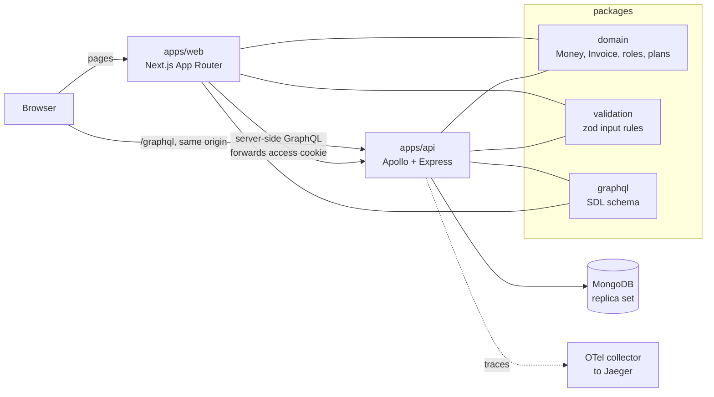

# Ledgerly codebase tour

How the code is laid out, how a request moves through it, and the few rules that keep it correct.
Read it once from top to bottom, then keep it open while you read the code.

Written as of the end of Phase 4. When the code and this page disagree, the code and
[`CLAUDE.md`](../CLAUDE.md) win, and this page should be fixed.

| Product                | Front end            | API                        | Data                  | Language                | Repo                      |
| ---------------------- | -------------------- | -------------------------- | --------------------- | ----------------------- | ------------------------- |
| Multi-tenant invoicing | Next.js 16, React 19 | Apollo Server 5, Express 5 | MongoDB 9, Mongoose 9 | TypeScript 6.0, Node 24 | pnpm + Turborepo monorepo |

## Contents

1. [What Ledgerly is](#1-what-ledgerly-is)
2. [The map](#2-the-map)
3. [Shared packages](#3-shared-packages)
4. [The API](#4-the-api-appsapi)
5. [The web app](#5-the-web-app-appsweb)
6. [One request, end to end](#6-one-request-end-to-end)
7. [Doing things exactly once](#7-doing-things-exactly-once)
8. [The rules and why](#8-the-rules-and-why)
9. [How we test](#9-how-we-test)
10. [Adding a feature](#10-adding-a-feature)
11. [Your first week](#11-your-first-week)
12. [Known gaps](#12-known-gaps)
13. [Glossary](#13-glossary)

## 1. What Ledgerly is

A small business signs up, creates an **organisation**, adds **customers**, writes **invoices**,
sends them, and records **payments** by hand or by card. One person can belong to several
organisations, each with its own role. The organisation is the **tenant**: nothing from one
organisation may ever leak into another.

It is built in phases as a learning project, so every phase ends with a write-up in
[`docs/learn/phase-N.md`](learn/). Those notes explain the _why_ behind this page in more depth.

| Phase | Scope                     | State   |
| ----- | ------------------------- | ------- |
| 0     | Plan and ADRs             | done    |
| 1     | Monorepo, domain, CI      | done    |
| 2     | API, tenancy, auth        | done    |
| 3     | Web shell                 | done    |
| 4     | Invoices, payments, plans | done    |
| 5     | Admin console             | next    |
| 6–8   | PDFs, theming, AWS        | planned |

Nothing is deployed to AWS yet. Everything runs locally in Docker; the cloud work is Phase 8.

## 2. The map

The browser only ever talks to one origin. The Next.js server renders pages and calls the API on
the user's behalf; the browser calls the API directly for anything interactive. Both share three
packages, so the rules for money, invoices and validation exist exactly once.



```text
ledgerly/
├─ apps/
│  ├─ api/            GraphQL API: data, tenancy, auth, payments
│  └─ web/            Next.js tenant app (pages, components, Redux, Apollo)
├─ packages/
│  ├─ domain/         pure business rules, zero dependencies
│  ├─ validation/     zod schemas shared by forms and resolvers
│  ├─ graphql/        the .graphql schema files, the API's contract
│  └─ config/         shared TypeScript and lint config
├─ docs/adr/          architecture decisions (MADR), never edited once accepted
├─ docs/learn/        one learning note per phase
├─ infra/local/       OpenTelemetry collector config for the local stack
├─ PLAN.md            phases, gates, the whole design
├─ DECISIONS.md       every choice the plan did not make, newest first
└─ CLAUDE.md          the non-negotiable rules, in one page
```

**Folders are feature-first.** You will find `features/invoices/` holding the model, service,
resolvers and tests for invoices together, not a `models/` folder and a `services/` folder. When
you change a feature, you should rarely leave its folder.

## 3. Shared packages

### `packages/domain`: the rules of the business

Plain TypeScript with no dependencies and no I/O. It doesn't know MongoDB, GraphQL or React
exist, which is why the API _and_ the browser can both use it. A dependency rule fails CI if it
ever imports anything.

- **`money/`**: `Money` is a `bigint` count of minor units (cents) plus a `Currency`. Adding USD
  to EUR throws. There is no division; the only rounding is `multiplyAndRound`, half-even.
- **`invoice/`**: the state machine. A table lists which actions each status allows: `DRAFT` →
  edit, send, void; `SENT` → pay, void; `PARTIALLY_PAID` → pay; `PAID` and `VOID` → nothing.
- **`access/`**: roles (`OWNER`, `ADMIN`, `ACCOUNTANT`, `VIEWER`) and the
  `can(role, permission)` table.
- **`billing/`**: the plan catalogue. FREE allows 5 customers, 10 invoices a month and 2 seats;
  PRO and BUSINESS raise or remove those limits.
- **`shared/`**: `Result` (`ok` / `err`). Expected business refusals, such as overpaying an
  invoice, are returned as values, not thrown.

```ts
// Why bigint and not number: 0.1 + 0.2 !== 0.3 in floating point.
const total = Money.parse('19.99', USD).add(Money.parse('0.01', USD)); // 2000n minor units, exact
Money.of(500n, USD).add(Money.of(500n, EUR)); // throws CurrencyMismatchError
```

### `packages/validation`: what valid input looks like

zod schemas such as `CreateInvoiceInput`. The web form validates with the same schema the API
uses, so the user sees the same rule before and after submitting. A _contract test_ checks every
GraphQL input type has a matching zod schema with the same fields.

### `packages/graphql`: the API contract

The schema is written first, by hand, in `schema/tenant/*.graphql`. Code generation turns it into
TypeScript types for both apps, so if the schema and the code disagree, the build fails.

## 4. The API (`apps/api`)

Read `src/` as layers, outside in. A request passes through each of them in this order.

| Folder       | Job                                                                                                                               | Start reading at               |
| ------------ | --------------------------------------------------------------------------------------------------------------------------------- | ------------------------------ |
| `http/`      | Express app: rate limit per IP, cookies, the request context, then Apollo. Also the REST refresh and logout routes.               | `app.ts`                       |
| `context/`   | Who is calling and for which organisation, stored in `AsyncLocalStorage` so any code below can read it without passing it around. | `request-context.ts`           |
| `graphql/`   | Schema assembly, scalars, error formatting, depth and alias limits, pagination, DataLoaders.                                      | `schema.ts`, `errors.ts`       |
| `features/*` | One folder per feature: Mongoose model, service (the logic), resolvers (thin GraphQL glue), tests.                                | `invoices/invoices.service.ts` |
| `data/`      | Database connection, transactions, and the **tenant guard**. The only place allowed to touch the raw MongoDB driver.              | `tenant-guard.ts`              |

### Tenancy: how organisations stay apart

Every tenant collection (customers, invoices, payments…) has an `orgId`. You never write
`{ orgId }` in a query yourself. The tenant guard, a Mongoose plugin, adds it from the request
context to every query and aggregate, and refuses to run if there is no organisation. The
`orgId` never comes from a GraphQL argument, because a caller could put any value there.

> **Gotcha:** Mongoose queries are lazy: `Invoice.find()` does nothing until awaited. Build a
> query inside one tenant context and await it outside, and it runs with no organisation. That's
> why every query chain ends in `.exec()` where it is built.

### Errors come in two kinds

- **GraphQL errors** for "you can't ask this": `UNAUTHENTICATED`, `FORBIDDEN`,
  `BAD_USER_INPUT`.
- **`userErrors` in the payload** for "the business says no": `OVERPAYMENT`,
  `PLAN_LIMIT_REACHED`, `CARD_DECLINED`. Each has a stable `code` and a `field` path, so the form
  can show the message next to the right input, translated.

Anything unexpected is logged in full and returned as "Something went wrong on our side" with a
`traceId`. No stack traces reach the client.

### Authentication

Hand-rolled on purpose so you can see every part ([ADR-0003](adr/0003-hand-rolled-session-auth.md)).
Passwords are hashed with argon2id. Sign-in sets two cookies, both `HttpOnly` so JavaScript can't
read them:

- `__Host-at`: a 10-minute access token (an EdDSA JWT) holding only the user and session ids.
  **Roles are not in it**; they are loaded on every request, so a role change applies
  immediately.
- `__Secure-rt`: a refresh token, sent only to `/graphql/auth`, replaced on every use. Presenting
  an old one twice looks like theft and revokes the whole session.

## 5. The web app (`apps/web`)

```text
src/
├─ app/[locale]/              routes; the locale (en, de, ar) is the first URL segment
│  ├─ (auth)/sign-in, sign-up route group: shared layout, not in the URL
│  └─ o/[orgSlug]/            one organisation's app: dashboard, customers, invoices, billing
├─ features/                  auth, shell, customers, invoices, billing, dashboard
├─ components/form/           Field, SelectField, error mapping, useZodForm
├─ lib/apollo/                rsc.ts (server client), ApolloWrapper.tsx (browser client), links
├─ lib/auth/                  single-flight token refresh, RestoreSession
├─ lib/hooks/                 useIdempotencyKey, usePermission, useMoney, useToast
├─ store/                     Redux Toolkit: ui, toasts, session slices + middleware
├─ messages/{en,de,ar}.json   every visible string, by key
└─ proxy.ts                   picks the locale (Next 16's name for middleware.ts)
```

### Server Components and client components

Files under `app/` are **Server Components** by default: they run only on the server, can be
`async`, and send no JavaScript. A file that starts with `'use client'` is a **client
component**: rendered on the server for the first HTML, then made interactive in the browser.

Our rule of thumb: **fetch on the server, interact on the client.** A page loads its data in a
Server Component, then hands it to a client component, either directly or with
`<PreloadQuery>` + `useReadQuery` so the client can paginate and refetch.

### Who owns which state

| State                                | Owner                     | Example                          |
| ------------------------------------ | ------------------------- | -------------------------------- |
| Data from the server                 | Apollo cache              | invoices, customers, plan usage  |
| What the URL says                    | The URL itself            | invoice filters (`?status=SENT`) |
| App-wide UI state                    | Redux Toolkit             | theme, toasts, mobile menu       |
| One component's state                | `useState` / `useReducer` | invoice line items in the editor |
| "Show it before the server confirms" | `useOptimistic`           | a payment appears as pending     |

The Redux store is created **once per request** by `StoreProvider`. A store at module level
would be shared by every user the Node server is rendering for, leaking one person's state into
another's page.

### Translations and accessibility are part of done

- No visible English in components. Strings live in `messages/*.json` and every key exists in
  all three locales.
- Arabic is right to left. CSS uses logical properties (`margin-inline-start`, not
  `margin-left`), so there is no separate RTL stylesheet.
- Every input has a label; errors are linked to their field with `aria-describedby`; component
  tests run axe and fail on violations.

## 6. One request, end to end

Follow a card payment on an invoice. Open each file as you read its step.

1. **`apps/web/src/app/[locale]/o/[orgSlug]/invoices/[invoiceId]/page.tsx`**: the invoice page is
   a Server Component. It queries the API with the user's access cookie (and only that cookie)
   and the `x-org` header naming the organisation.
2. **`features/invoices/PaymentForms.tsx`**: the user submits the card form.
   `useIdempotencyKey` already holds a UUID for this attempt; `useOptimistic` shows the payment
   as pending straight away.
3. **`lib/apollo/links.ts`**: the browser's Apollo client sends `payInvoiceByCard` to `/graphql`
   on the same origin. If the access token has expired, the refresh link renews it once and
   retries.
4. **`apps/api/src/http/app.ts` → `rate-limit.ts`**: the per-IP limiter runs first. Then the
   request context reads the cookie, verifies the token, loads the session and the caller's
   membership of `x-org`.
5. **`features/invoices/invoices.resolvers.ts`**: the resolver checks the permission
   (`payments:record`) and calls the service. Resolvers stay thin.
6. **`features/invoices/invoices.service.ts` → `payInvoiceByCard`**: if this idempotency key has
   already succeeded, return that result. Otherwise ask the domain whether the payment is legal,
   charge the card _outside_ any transaction, then record it in a transaction. If recording
   fails, refund the charge.
7. **`data/tenant-guard.ts`**: every query in that transaction gets `orgId` from the context
   automatically.
8. **Back in the browser**: the response replaces the optimistic row. A `userErrors` code such as
   `CARD_DECLINED` is translated and shown next to the card field.

Every step appears in one trace in Jaeger (<http://localhost:16686>), down to each MongoDB
command, and every log line carries the same `traceId`.

## 7. Doing things exactly once

Most of the hard code in this repository exists to stop something happening twice, or not at
all. Learn these five patterns and the rest reads easily.

**Idempotency keys: a double click records one payment.** The form sends a UUID with each
money-moving mutation. The API runs the first request and stores its outcome in the same
transaction; any repeat with that key gets the stored outcome back. The key is renewed only after
a success, so a retry after a network error is the same request. See `features/idempotency/`.

**Transactions: two payments can't overpay an invoice.** `recordPayment` reads the invoice, asks
the domain, writes the payment and updates the invoice in one MongoDB transaction. Two at once
conflict; the driver retries the loser, which then sees the new balance. The test fires ten
payments of 30.00 at a 100.00 invoice and expects exactly three to succeed.
See [ADR-0002](adr/0002-payment-and-numbering-integrity.md).

**Write skew: ten parallel creates on FREE give exactly five customers.** "Count, then insert" is
not safe even inside a transaction, because two transactions can each count four and each insert
one without touching the same document. `checkCapacity` first writes a lock document
(`touchLock`) that every creator writes, which forces them to conflict. See
`features/billing/limits.ts`.

**External side effects: a card is never charged twice.** A database transaction may be retried;
a card charge must not be. So the charge happens outside the transaction, with a gateway key made
from our idempotency key _plus_ the charge details (`gatewayKey`), and a failed recording is undone
with a refund. The gateway is a stand-in, `PaymentGatewaySimulator`; test cards are
`pm_card_visa` and `pm_card_declined`.

**Numbering and email: no gaps, no duplicates.** Invoice numbers come from a per-organisation
counter incremented inside the send transaction, so a failed send uses no number. Emails are
written to an **outbox** collection in the same transaction as their cause, so a rolled-back
change sends nothing.

## 8. The rules and why

[`CLAUDE.md`](../CLAUDE.md) lists the rules that are never broken. Most are enforced by a tool,
so you'll hear about a break in CI rather than in review.

| Rule                                                | Why                                                                  | Enforced by                                |
| --------------------------------------------------- | -------------------------------------------------------------------- | ------------------------------------------ |
| Money is `Money`, never a `number`                  | Floating point loses cents                                           | Types, review                              |
| No currency mixing, no FX                           | A total across currencies is meaningless                             | `CurrencyMismatchError`                    |
| `domain` imports nothing                            | So it runs in the API and the browser                                | dependency-cruiser                         |
| `orgId` comes from the context, never arguments     | A caller could pass someone else's id                                | Tenant guard, tenant-leak test             |
| Every new Query/Mutation is in the tenant-leak test | A new resolver is a new way to leak data                             | The leak test fails on any uncovered field |
| Roles loaded per request, not from the token        | A demoted user loses access at once                                  | Auth tests                                 |
| Tokens never in `localStorage`                      | Any injected script could steal them                                 | HttpOnly cookies                           |
| GraphQL types separate from DB and domain types     | Changing one must not silently change the others                     | Codegen mappers                            |
| Client components don't fetch during SSR            | The server has no browser cookies; it fails silently                 | The SSR Apollo client throws               |
| `'use client'` files export only components         | A server file importing a constant gets a placeholder, not the value | `client-boundary.test.ts`                  |
| Card charges never inside a transaction             | Retries would charge twice                                           | Review, billing tests                      |
| No red builds, no TODOs in a finished phase         | Unfinished work is listed openly instead                             | CI, grep before commit                     |

When the plan doesn't say how to do something, the choice goes in
[`DECISIONS.md`](../DECISIONS.md). A bigger architectural choice gets an ADR in
[`docs/adr/`](adr/); accepted ADRs are never edited, only replaced by a new one (ADR-0005
replaced part of ADR-0003 this way).

## 9. How we test

| Tier           | Tests | What is real, what is not                                                                                 |
| -------------- | ----: | --------------------------------------------------------------------------------------------------------- |
| Domain         |   160 | Pure functions, no mocks. 100% coverage.                                                                  |
| Validation     |     7 | zod schemas.                                                                                              |
| API            |   144 | Real HTTP, real MongoDB replica set in Testcontainers, a movable test clock.                              |
| Web components |    74 | React Testing Library in jsdom; queries by role and label; axe on every render.                           |
| End to end     |    11 | Playwright against the real API and web server on a fresh database. Fails if either server logs an error. |

Four test files are worth reading before any feature code: `apps/api/test/tenant-leak.test.ts`
(can org A see org B?), `concurrency.test.ts` (races), `auth.test.ts` (refresh, theft, CSRF) and
`apps/web/e2e/invoices.spec.ts` (the full create → send → pay journey).

> **House habit:** when a test guards something important, break the code on purpose and watch
> the test fail, then put it back. A test you have never seen fail may not be testing anything.
> The learning notes list each of these "mutation checks".

## 10. Adding a feature

Say you add "archive a customer". The order that keeps the build green:

1. Domain rule first, with tests, if there is one (can a customer with unpaid invoices be
   archived?).
2. Schema: add the mutation to `packages/graphql/schema/tenant/customers.graphql`, returning a
   payload with `userErrors`.
3. Input rules: add the zod schema to `packages/validation`. The contract test will remind you.
4. Run `pnpm --filter @ledgerly/api codegen`.
5. Service in `features/customers/`: the logic, in a transaction if it writes more than one
   document.
6. Resolver: check the permission, call the service, return its result.
7. Add the mutation to `tenant-leak.test.ts`: aimed at another organisation's customer, it must
   say `NOT_FOUND`.
8. Web: add the document to `graphql/documents.ts`, run the web codegen, build the component, add
   strings to all three message files.
9. Component test with RTL and axe; an E2E step if it's part of a main journey.
10. `pnpm check` green, then a `DECISIONS.md` line for anything the plan didn't specify.

## 11. Your first week

```bash
pnpm install
make up          # MongoDB replica set, OTel collector, Jaeger
make env         # .env with generated dev keys (never commit it)
make api         # http://localhost:4000/graphql
make web         # http://localhost:3000
pnpm check       # everything CI runs
```

- **Day 1:** run the stack, sign up, create a customer, send an invoice, pay it with
  `pm_card_visa`. Find that payment's trace in Jaeger.
- **Day 2:** read [`PLAN.md`](../PLAN.md) §1–3 and the five ADRs. Then `packages/domain`, tests
  first.
- **Day 3:** read the API in layer order (`http` → `context` → `graphql` → `features/invoices` →
  `data`), then [`docs/learn/phase-2.md`](learn/phase-2.md).
- **Day 4:** read the web app from one route down: the invoices page, its components, the Apollo
  setup. Then [`phase-3.md`](learn/phase-3.md) and [`phase-4.md`](learn/phase-4.md).
- **Day 5:** do two exercises from the learning notes: remove `touchLock` and run the billing
  tests; set `REFRESH_GRACE_MS` to 0 and run the auth tests. Explain each failure to a teammate.

## 12. Known gaps

Listed openly so nobody mistakes them for finished work:

- No invoice PDFs, customer deletion or time-zone editing yet. Plan features (branding, MFA,
  audit export) are in the catalogue but not enforced.
- Upgrades charge the full month; there is no proration.
- The per-IP rate limit is per API process, and server-rendered pages share the web server's IP.
  Both must be fixed before deploying (Phase 8).
- German and Arabic text needs review by native speakers.
- No AWS infrastructure exists yet; LocalStack is defined but unused.

## 13. Glossary

| Term               | Meaning                                                                                                                      |
| ------------------ | ---------------------------------------------------------------------------------------------------------------------------- |
| Tenant             | An organisation. The unit of data isolation.                                                                                 |
| Minor units        | The smallest unit of a currency: cents for USD, none for JPY. Money is stored as a whole number of these.                    |
| Half-even rounding | "Banker's rounding": a value exactly halfway rounds to the even neighbour (2.5 → 2, 3.5 → 4), so errors don't drift one way. |
| Idempotent         | Doing it twice has the same effect as doing it once.                                                                         |
| Write skew         | Two transactions each read the same data, each make a change that's valid on its own, and together break a rule.             |
| Outbox             | Outgoing messages saved as rows in the same transaction as their cause, sent later by a worker.                              |
| RSC                | React Server Component: renders only on the server and ships no JavaScript.                                                  |
| Hydration          | The browser attaching event handlers to HTML the server already rendered.                                                    |
| ADR                | Architecture Decision Record: one decision, its context and its consequences.                                                |
| `*Simulator`       | A deliberate stand-in for an outside service, named so nobody mistakes it for the real one. Listed in the README.            |
